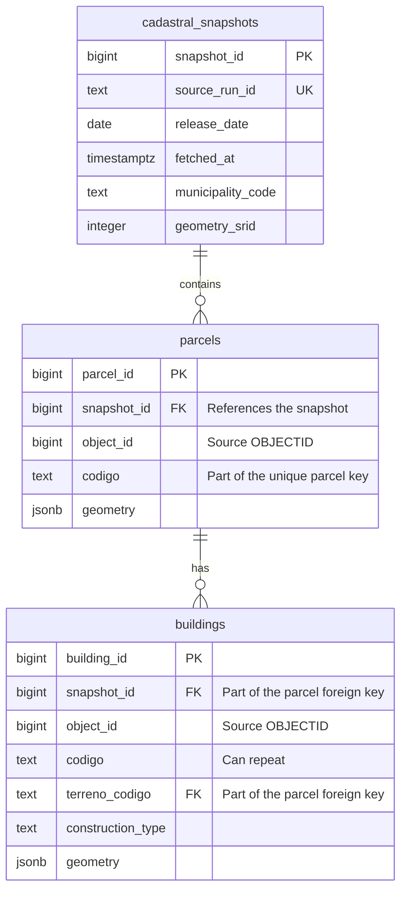

# Milestone 2 Database Schema

The `igac` schema stores cadastral data for the Pasto mapping pilot. A snapshot records one saved download. Parcels belong to a snapshot, and buildings belong to parcels from that same snapshot. [SQL definitions](../db/schema.sql)

## Entity relationship diagram

All three tables are in `igac`. The building foreign key uses two columns together. `buildings (snapshot_id, terreno_codigo)` references the unique pair `parcels (snapshot_id, codigo)`. Each building therefore belongs to exactly one parcel in the same snapshot. A parcel can have zero or more returned building records.

## Design decisions

- **Record identity.** PostgreSQL generates the primary keys. The source run ID is unique. Within each snapshot, each layer's source `OBJECTID` is unique, and each parcel code is unique. Building codes can repeat, so distinct building rows are kept.
- **Source values.** Cadastral codes are stored as text to preserve all digits. The schema checks for positive source IDs, 30-digit cadastral codes, and a nonblank construction type. Department code is nullable because it was null for all 500 saved parcels.
- **Geometry.** The loader preserves the ArcGIS polygon rings in `jsonb` and checks the coordinate system on every page. The saved pages report ArcGIS `wkid` 102100 with `latestWkid` 3857. The snapshot stores EPSG:3857.
- **Audit timestamps.** Every table has `first_seen_at` and `last_updated_at`. PostgreSQL sets both on insert. The loader preserves `first_seen_at` and updates `last_updated_at` only when stored values change.

## Access roles

| Role | Verified access |
|---|---|
| Setup role | Owns the schema and creates its tables and constraints. |
| `igac_loader` | Connects directly to PostgreSQL. It can use the `igac` schema, read and insert rows in the three tables, and update selected source fields and `last_updated_at`. It cannot delete or truncate rows or create permanent tables. |
| `app_reader` | Has `USAGE` on `igac` and `SELECT` on the three tables. Effective permission checks confirmed it cannot insert, update, delete, truncate, or create permanent database objects. |
| `PUBLIC`, `anon`, and `authenticated` | Have no direct grants on the `igac` schema, tables, or sequences. |

The loader has no direct application sequence permissions. PostgreSQL still generates identity values on insert. The permission checks found no access to unrelated application tables, views, sequences, or routines. The shared database `PUBLIC TEMPORARY` grant still permits temporary tables. The Supabase Data API is disabled.

Separate permission checks for `app_reader` found no access to unrelated application data, application sequences, or routines. Its connection string is stored locally as `APP_DATABASE_URL` in the ignored `.env` file. A direct login as `app_reader` passed, and a read-only transaction returned 1 snapshot, 500 parcels, and 1,218 buildings.

## What we verified in Supabase

- The three tables were created, and their keys, constraints, audit columns, and access restrictions passed verification.
- The saved run loaded as **one snapshot, 500 parcels, and 1,218 buildings**. Every building linked to a parcel in the same snapshot.
- The second load of the same files reported every row unchanged. Record IDs, `first_seen_at`, and `last_updated_at` were identical before and after the rerun.
- Of the 500 parcels, 422 had at least one returned building match and 78 had none. The vacancy status of those 78 parcels is unknown.

The saved run demonstrates the Pasto pilot. Coverage for Manizales and current site conditions remain unverified. [Data quality report](data_quality.md) · [Verified query definitions](../db/queries.sql)
